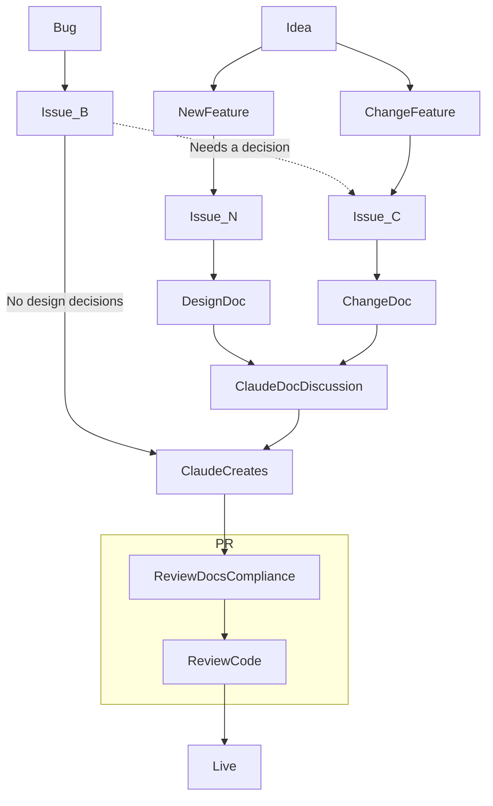

The basic premise is to try something different. I want to feel ownership and be in control of at least some parts of the app. Real Managers also write docs, not just talk through their idea. 

Ideally:
- all parts I care about have a doc
  - current features will have docs added on the go
- claude implements the doc 
- _PRs check compliance with docs_ (down the line)
- feature changes go through docs
- bugs are unrealated, unless they arrouse because of an imprecice doc
- Docs don't need to explain the feature in full detail, just in the extend I care bout
- No change log in docs, they are in git after all
- They are for me, It does not mean other's can't change stuff described there, rather I just want to be part of those changes